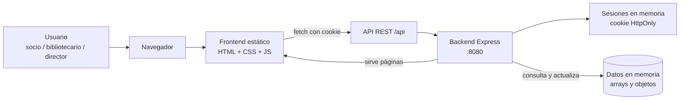
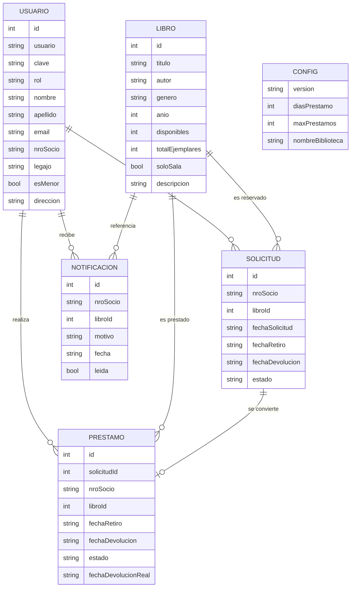
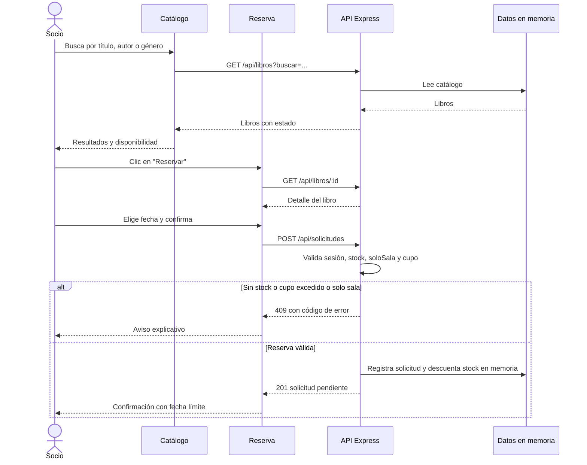
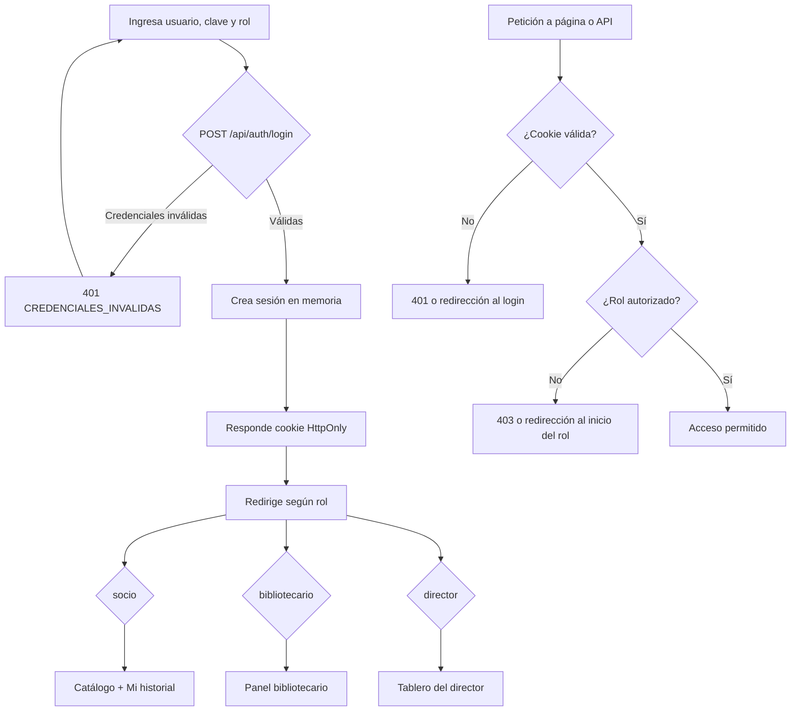
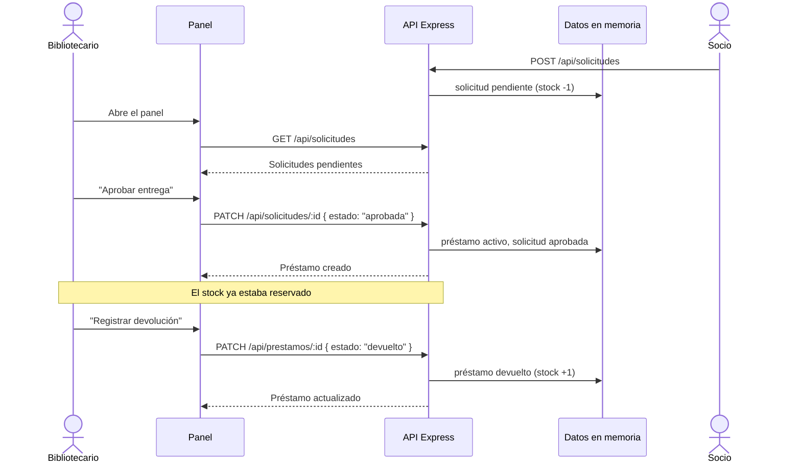
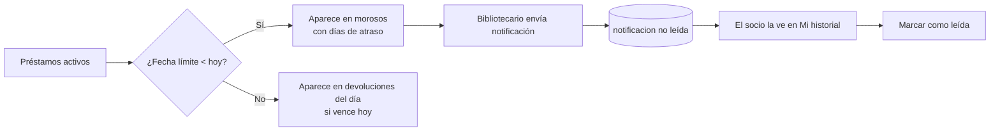
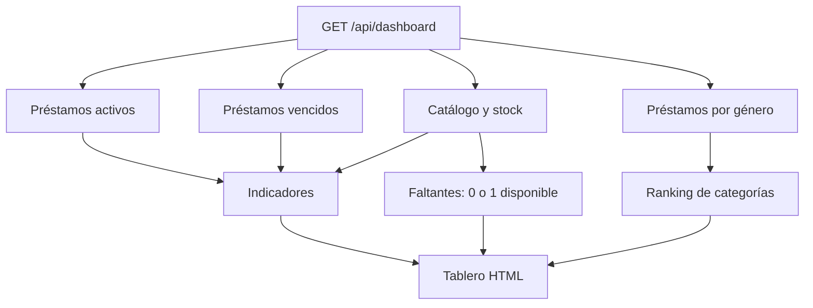

# Diagramas de BiblioTech

Diagramas en formato [Mermaid](https://mermaid.js.org/). Se visualizan
directamente en GitHub, GitLab, VS Code (extensión Markdown Preview Mermaid) y
en <https://mermaid.live>.

---

## 1. Arquitectura general

**Capas:**

1. **Navegador**: HTML semántico, CSS y `scripts.js` como cliente de la API.
2. **Express**: sirve `frontend/`, protege páginas, valida sesión y roles.
3. **Dominio**: reglas de negocio (cupo, solo sala, stock, vencidos, privacidad).
4. **Datos**: estructuras en memoria (arrays y objetos), reiniciadas desde la semilla al arrancar.

---

## 2. Modelo de datos (esquema v2)

**Estados:**

- `solicitud.estado`: `pendiente` → `aprobada` o `rechazada`.
- `prestamo.estado`: `activo` → `devuelto`.
- `libro.soloSala = true`: no se presta, solo consulta en sala.

---

## 3. Flujo de reserva de un libro

---

## 4. Flujo de login y autorización

---

## 5. Flujo de aprobación y devolución

---

## 6. Flujo de morosos y notificaciones

---

## 7. Tablero del director

